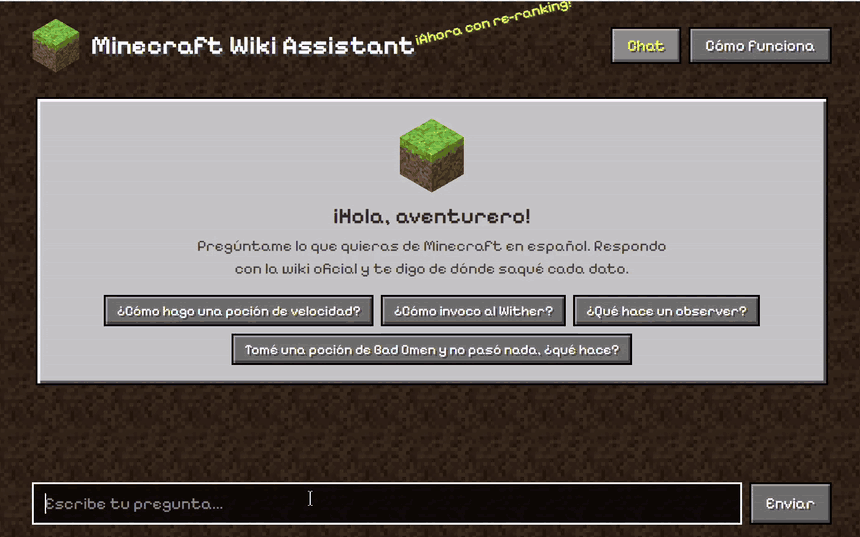
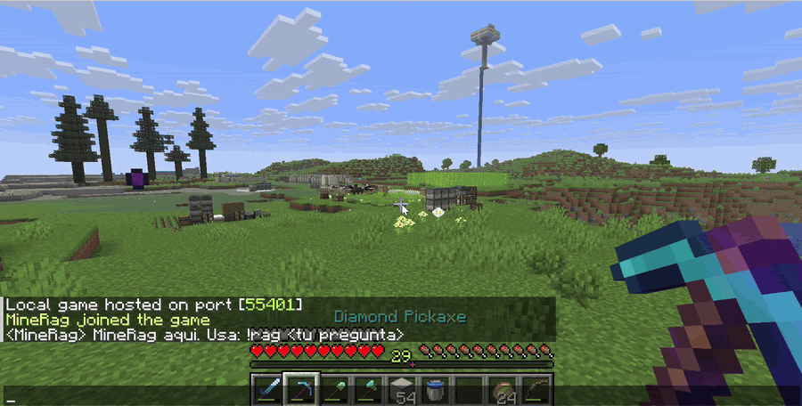
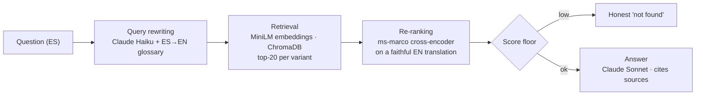

# Minecraft Wiki RAG Assistant

[](https://github.com/argomezflores/minecraft-rag/actions/workflows/ci.yml)

Ask Minecraft questions in Spanish and get answers grounded in the official [Minecraft Wiki](https://minecraft.wiki), with cited sources. The assistant can be used from a web chat widget, a REST API, or an in-game bot that replies in the Minecraft chat.

It is built from scratch in Python, without LangChain. It has a wiki scraper that keeps crafting and brewing recipes, a custom chunker, local embeddings in ChromaDB, cross-encoder re-ranking, and Claude for query rewriting and answer generation. An evaluation harness drove every fix and records each one.

<p align="center">
  
  <br><em>Real recording of the web chat, sped up 1.5×.</em>
</p>

## Why I built this

My brothers and I came back to Minecraft after years away. The game had changed a lot in the newer versions, and much of what we used to know was gone, even crafting recipes we once had memorized. We were relearning the game from scratch.

The moment that started this project: we drank a Bad Omen potion, nothing happened, and none of us knew what it was supposed to do. We didn't want to stop playing to dig through the wiki every time something like that came up. We wanted to ask in Spanish, without leaving the game, and get an answer we could trust.

So now we keep playing the same world, and when a question comes up, we ask the assistant right from the game chat. This is that first question, asked inside our world:

<p align="center">
  
  <br><em>Real recording in our survival world (typing sped up 2×, waiting 1.5×).</em>
</p>

In short: Bad Omen does nothing until you walk into a village, where it triggers a raid. That explains why nothing happened.

## Results

The evaluation set has 30 hand-labeled questions in Spanish about potions, redstone components, and crafting. Three of them are out of scope (a "ruby sword", installing Forge mods, a "flight potion"), and for those the correct behavior is to say the answer is not in the wiki.

| Metric | Baseline | Final (2 runs) |
|---|---|---|
| Correct source ranked #1 | 52% | **100%** (27/27 in both) |
| Correct source in top 5 | 78% | **100%** |
| Expected facts present in the answer | 0.59 | **0.89 – 0.94** |
| False "not found" answers | 7 / 27 | **0 / 27** |
| Out-of-scope questions correctly declined | 3 / 3 | 3 / 3 |
| Index size | 113,584 chunks | 8,408 chunks (10,963 after the coverage expansion below) |
| Median latency | 6.4 s | 6.4 – 6.8 s |

Raw results are in [`data/benchmarks/`](data/benchmarks/), and every change is documented in [`docs/eval-log.md`](docs/eval-log.md) (in Spanish). Most of the remaining "missing facts" are labeling artifacts. For example, the answer says "any stone-tier block" where the label expected "Cobblestone", or "delay" where it expected "tick". Query rewriting is not deterministic, so the final numbers come from two consecutive runs.

**Coverage expansion.** Afterwards, 213 articles were added on mobs, bosses, structures, dimensions and biomes, for a total of 1,242 articles and 10,963 chunks. 18 April Fools, removed and Education-only pages were excluded. Six new questions (Ender Dragon, Creeper, Wither, Nether Fortress, reaching the End, Deep Dark) were written before seeing any result and were not used for tuning. They went from **1/6 to 5/6** correct sources (6/6 in the top 5), with no regressions on the original questions.

**Real players.** My brothers then used the in-game bot during our survival game and asked 7 questions in their own words, including troubleshooting ones like "why won't my villagers breed?" and typos like "encatamiento". All **7/7** were answered with the right source and the expected facts. In total, **12 of 13** questions never used for tuning were answered correctly.

## How it works



**Indexing.** Articles come from the MediaWiki API as wikitext. `{{Crafting}}`, `{{Smelting}}` and `{{Brewing}}` templates are converted into sentences before markup is stripped. The text is split into 800-character chunks with 150 characters of overlap, and each recipe line is also stored as its own chunk. Chunks are embedded with `all-MiniLM-L6-v2` and stored in ChromaDB.

**Querying.**
1. Claude Haiku produces a faithful English translation and two search-oriented rewrites. A Spanish→English glossary of 120+ terms adds a deterministic variant.
2. Each variant retrieves the top 20 chunks.
3. A cross-encoder re-scores the merged pool against the English translation.
4. If even the best chunk scores too low, the API answers "not found" without calling the LLM.
5. Otherwise, Claude Sonnet answers using only the retrieved context.

## Quickstart

Requirements: Python 3.12 and an [Anthropic API key](https://console.anthropic.com/).

```bash
git clone https://github.com/argomezflores/minecraft-rag.git
cd minecraft-rag
python -m venv .venv
source .venv/bin/activate          # Windows: .venv\Scripts\activate
pip install -r requirements.txt
cp .env.example .env               # then set ANTHROPIC_API_KEY
python scripts/ingest_all.py --reset   # builds the vector index (~3 min on CPU)
uvicorn src.api:app
```

Open <http://localhost:8000/widget/>, or call the API directly:

```bash
curl -X POST http://localhost:8000/query -H "Content-Type: application/json" \
  -d '{"question": "Como hago una pocion de velocidad?"}'
```

The wiki corpus (1,242 articles) is versioned in [`data/wiki/`](data/wiki/), so you don't need to scrape anything. Run `python scripts/scrape_wiki.py` only if you want to refresh it. The first run downloads the embedding and re-ranking models (~180 MB) from Hugging Face.

| Task | Command |
|---|---|
| Run the evaluation | `python scripts/benchmark.py --eval-set data/eval/eval_set.json --version my-run` |
| Run the unit tests | `pip install -r requirements-dev.txt` then `python -m pytest tests` |
| In-game bot (Node.js + Mineflayer) | see [`minecraft_bot/README.md`](minecraft_bot/README.md) |
| API docs (Swagger) | <http://localhost:8000/docs> |

## What the evaluation uncovered

The first version already looked like a "complete" RAG, with rewriting, re-ranking, a blocklist and score boosts, but it was still wrong half the time. Measuring each layer turned up these root causes:

1. **The chunker duplicated paragraphs ~110×.** When a paragraph break fell near the start of a window, the window advanced only one character per iteration. Long list-like articles turned into thousands of near-identical vectors that crowded out everything else. Fixing it shrank the index from 113K to 7.6K chunks and the ingest from ~15 min to under 3.
2. **Brewing recipes were silently dropped.** The wiki passes the base potion as a named parameter (`base=`), and named parameters don't count toward MediaWiki's positional numbering. The parser returned an empty string and the recipe disappeared.
3. **The re-ranker was blind to Spanish.** The `ms-marco` cross-encoder is English-only, and it scored every Spanish query against every chunk at ~0.000, so rankings fell back to a title heuristic. Re-ranking against a faithful English translation fixed it.
4. **Score clipping created ties.** Adding a title boost and then clipping to 1.0 tied the best 7 chunks of an article, so the recipe chunk could randomly fall out of the top 5.
5. **Recipes landed in the wrong chunk.** A size-based split could leave a "Crafting" heading at the end of one chunk and its recipe buried in the next one, surrounded by unrelated text. Each recipe line is now also stored as its own chunk, phrased as an answer ("How to make X (crafting): ..."), because the cross-encoder scores answer-shaped passages higher than bare ingredient lists.

The full write-ups (symptom, evidence, cause, options, decision, measured result) are in [`docs/eval-log.md`](docs/eval-log.md).

## Design decisions

- **No framework.** The chunker, retrieval and re-ranking are each a few dozen lines of code, so every behavior can be inspected and tested. The chunker bug above would have been hard to find behind an abstraction.
- **Local models where quality allows.** Embeddings and re-ranking run on CPU at no cost per query. Claude is used only where language understanding matters: Haiku for rewriting and Sonnet for the final answer.
- **Honest abstention.** A score floor and a strict grounding prompt make the assistant say "not found" instead of answering from the model's own memory. The eval tracks both correct and false abstentions.
- **Measure before tuning.** Every change was A/B-tested on the same evaluation set, and changes that only moved the numbers within run-to-run noise were labeled as such.

## Limitations

- The evaluation set is small (30 questions) and was labeled by hand. It was also used to find the bugs, so it is not a held-out test: expect lower numbers on unseen questions. It supports the before/after story, not a general accuracy claim.
- Answers are in Spanish while the corpus is in English. Item names stay in English on purpose, to match the wiki.
- Crafting recipes are flattened to ingredient lists, so the grid shape is lost. Wiki content generated by templates, such as tables and `{{crafting usage}}`, is not indexed.
- The corpus is a snapshot of selected categories: blocks, items, potions, enchantments, redstone, mobs, structures, dimensions, biomes and core mechanics. It does not include every article.
- Questions that describe something without naming it ("which blue mob flies and collects items?") often fail: the embedding search ranks the right article too low for the re-ranker to see it (eval log #014).
- Item and block coverage is partial (296 of 489 items, 462 of 767 blocks, eval log #015). Small inline templates such as Java/Bedrock edition markers and XP amounts are stripped from the text (#016).
- Multi-step questions whose answer is spread across several articles are answered only partially. For example, "how do I reach the End?" explains the portal but not that you first have to find a stronghold with Eyes of Ender.

## Project structure

```
src/            pipeline: scraper, chunker, embedder, retriever, reranker, rewriter, generator, API
scripts/        CLIs: scrape, ingest, benchmark, quick search/RAG tests
data/wiki/      versioned wiki corpus (CC BY-NC-SA 3.0)
data/eval/      evaluation set
data/benchmarks/ evaluation results per version
tests/          unit tests (chunker, recipe parsing, recipe chunks)
widget/         embeddable chat widget (vanilla JS)
minecraft_bot/  in-game bot (Node.js, Mineflayer)
docs/           eval log + design notes from earlier versions (Spanish)
```

## License and credits

- **Code:** [MIT](LICENSE), © 2026 Rogelio Gómez. This covers everything outside `data/wiki/`, including the web chat and its pixel-art textures.
- **Wiki content:** the articles in `data/wiki/` are © Minecraft Wiki contributors and stay under [CC BY-NC-SA 3.0](https://creativecommons.org/licenses/by-nc-sa/3.0/), not MIT. They are redistributed for non-commercial, educational use, and every answer links back to its source article.
- Minecraft is a trademark of Mojang Studios. This project is not affiliated with Mojang or Microsoft.
